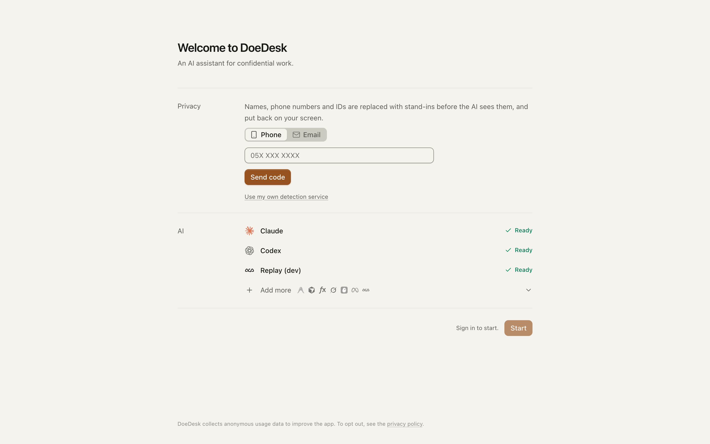

<p align="center">
  
</p>

<h1 align="center">DoeDesk</h1>

<p align="center">Use AI on confidential files.</p>

<p align="center">
  <a href="https://doedesk.com/download">Download</a> ·
  <a href="https://doedesk.com">Website</a> ·
  <a href="./docs/user/privacy.md">How masking works</a>
</p>

<p align="center">
  <picture>
    <source media="(prefers-color-scheme: dark)" srcset="./.github/readme/welcome-dark.png">
    
  </picture>
</p>

DoeDesk replaces names, phone numbers and IDs with stand-ins such as `[PERSON_FBJD2]` before an
AI model sees them, and puts the real values back on your screen and in the files it writes.

- **Your own AI subscription.** DoeDesk runs the agents you are already signed in to, such as
  Claude and Codex.
- **Real values stay on your computer.** The list that links each stand-in to a real value never
  leaves it. A request that cannot be checked is not sent.
- **Scans and images are masked too.** By default they are read and sent as masked text; you can
  choose to send the image itself with a labelled box over each value.
- **Your choice of detector.** Use DoeDesk Cloud ([server code](https://github.com/accelerate-sa/doedesk-server)),
  or run the detection service yourself.

## Install

Download DoeDesk from [doedesk.com/download](https://doedesk.com/download), or from the
[latest release](https://github.com/accelerate-sa/doedesk/releases/latest):

- **Mac** (Apple silicon): open `DoeDesk-arm64.dmg` and drag DoeDesk to Applications.
- **Windows** (x64): run `DoeDesk-x64.exe`. The installer is not code-signed yet, so Windows
  SmartScreen warns about an unrecognised app: choose **More info**, then **Run anyway**.
- **Linux** (x64 or arm64): make `DoeDesk-x86_64.AppImage` or `DoeDesk-arm64.AppImage`
  executable and run it, or install `DoeDesk-amd64.deb` / `DoeDesk-arm64.deb` with `apt`.

The Mac app, the Windows app and the AppImage update themselves. Sign in with a phone number in
Saudi Arabia, or by email anywhere.

## Run your own detection

DoeDesk needs one service to find names in text and, optionally, one to read documents. Any
server that answers these two calls works:

```
POST /v1/detect   { "texts": ["..."] }  ->  { "results": [{ "entities": [{ "start", "end", "kind" }] }] }
POST /v1/ocr      <image or PDF bytes>  ->  { "text": "..." }
```

Choose **Use my own detection service** when you sign in, or later under Settings, Privacy.
[docs/user/privacy.md](./docs/user/privacy.md) has the details and the limits.

## Build from source

```sh
curl -fsSL https://vite.plus | bash   # installs the `vp` command
vp i
vp run dev
```

`packages/privacy-gateway` holds the masking. It is plain Node with no dependency on the rest
of the app.

## Contact

This repository does not take issues or pull requests. Write to
[hello@doedesk.com](mailto:hello@doedesk.com).

## Credit

DoeDesk is a fork of [T3 Code](https://github.com/pingdotgg/t3code) by T3 Tools Inc. The agent
runtime, the interface and most of the code are theirs. DoeDesk adds the privacy gateway and
removes what is only for programming.

## Licence

DoeDesk is free software under the
[GNU Affero General Public License, version 3 or later](./LICENSE) (AGPL-3.0-or-later).

- **DoeDesk as a whole, and what Accelerate Technology Establishment wrote for it**, including
  `packages/privacy-gateway`, is under the AGPL.
- **The code that comes from T3 Code** is released by T3 Tools Inc. under the MIT licence. Their
  notice is kept in [LICENSE.T3-Code-MIT](./LICENSE.T3-Code-MIT), and that code remains available
  under MIT from [their repository](https://github.com/pingdotgg/t3code).
- **Versions up to and including `v2026.11.1`** were released under the MIT licence and remain
  under it.
- **An AI provider's own software** that DoeDesk loads or starts, such as the Claude Agent SDK
  and the Cursor SDK, is not free software and keeps its own terms. An additional permission
  under section 7 of the AGPL, in [NOTICE](./NOTICE), lets DoeDesk be shared together with it.
- **A commercial licence** is available from Accelerate Technology Establishment for those who
  cannot use the AGPL: see [COMMERCIAL-LICENSE.md](./COMMERCIAL-LICENSE.md) or write to
  [hello@doedesk.com](mailto:hello@doedesk.com).

[NOTICE](./NOTICE) states this in full.

The app links to the source of the version it is running under **Settings, About, Source code**.
If you change DoeDesk and let other people use your version over a network, the AGPL (section 13)
requires you to offer them your source: set `SOURCE_REPOSITORY_URL` in
`packages/shared/src/sourceCode.ts` to where you publish it.
